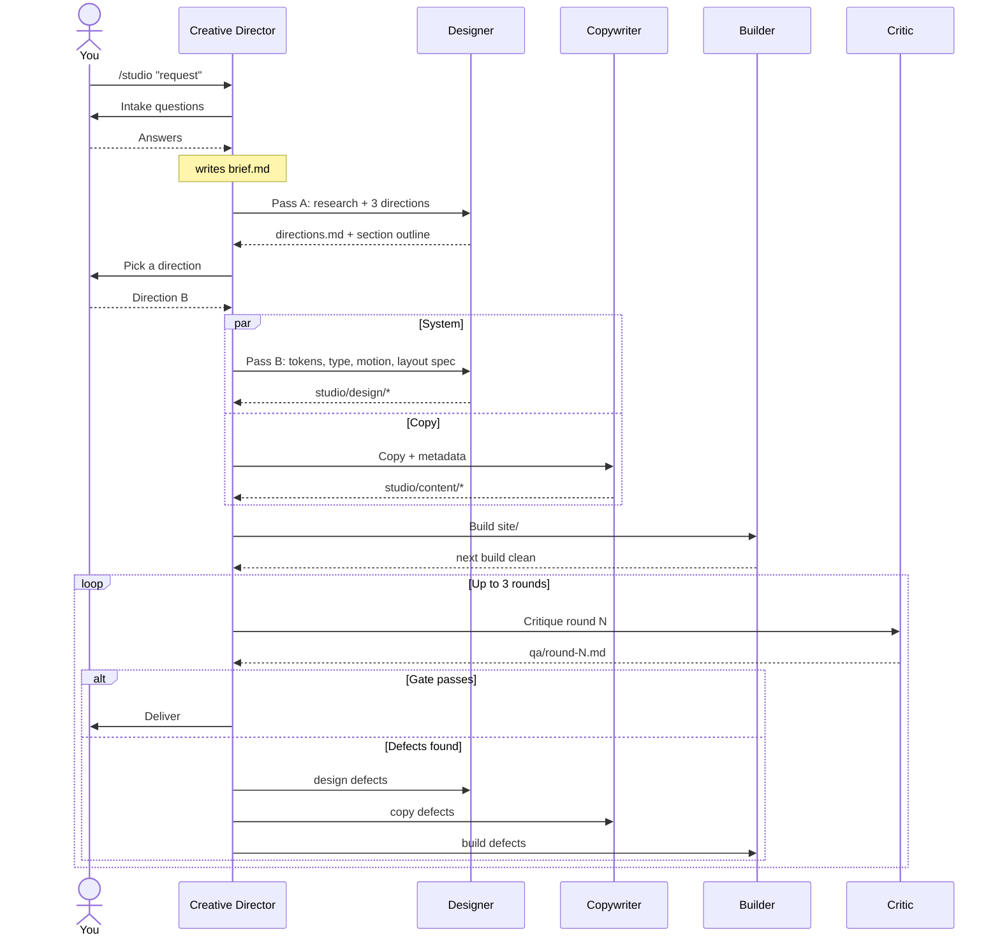

# Web Studio: Lean Squad

A team of 5 bots that designs and builds intricate, beautiful webpages.

- **Status:** design only. No agent files have been built yet (see [Build notes](#7-build-notes)).
- **Runs in:** Claude Code. One orchestrator session plus 4 subagents.
- **Stack:** Next.js (App Router) + React + TypeScript + Tailwind CSS v4 + Motion (formerly Framer Motion).
- **Date:** 2026-10-29

---

## 1. Overview

### Goal
Produce award-level marketing pages, landing pages and small sites. The target is the kind of work featured on Awwwards or Godly, not a template with the logo swapped. "Intricate" here means a clear concept carried through type, color, layout, motion and micro-detail, with the craft verified by screenshots and audits rather than assumed.

### How it runs

```
            You
             │  /studio "landing page for …"
             ▼
   ┌────────────────────┐
   │ Creative Director  │  main Claude Code session (the /studio skill)
   └─────────┬──────────┘
     dispatches subagents, reads their handoff files
     ┌───────┼──────────┬───────────┐
     ▼       ▼          ▼           ▼
 Designer  Copywriter  Builder    Critic
```

The Creative Director is the main session, not a subagent. Claude Code subagents can't spawn other subagents, so the bot that runs the pipeline has to be the top-level session. The other 4 bots are subagents. They talk to each other only through files in `studio/`, never through chat, so every decision stays inspectable and can be re-run.

### Taste guardrails (every bot follows these)

Every page must have:
1. **A named concept**: a one-line idea or metaphor that explains every design choice ("the roast curve", "field notes", "a quiet gallery").
2. **A deliberate grid**: a declared column system, with intentional breaks from it.
3. **Real typographic hierarchy**: a fluid type scale with obvious contrast between display and text.
4. **Generous whitespace**: spacing from a scale, never ad hoc values.
5. **At least 1 signature moment**: something memorable, such as a scroll-linked reveal, a generative hero, an unexpected layout or a crafted interaction.
6. **Real copy**: written for this brand, at the right length for the layout.

Banned, because these make a page look AI-generated:
- default purple-to-blue gradients
- Inter, or a single system font, as the only typeface
- centered hero, then three identical cards, then a CTA, as the whole page
- emoji used as icons
- lorem ipsum or "Feature one / Feature two" placeholders
- glassmorphism or glow effects with no concept behind them
- animating everything; motion must have a purpose

---

## 2. The team at a glance

| # | Bot | One-line role | Runs as | Model | Merges these specialist roles |
|---|---|---|---|---|---|
| 1 | **Creative Director** | Owns the vision, the brief, the pipeline and final sign-off | Main session (`/studio` skill) | Opus | Creative Director, Brand Strategist, UX / Information Architect |
| 2 | **Designer** | Makes the page beautiful on purpose: concept, visual system, layout spec | Subagent | Opus | Inspiration Scout, Art Director, Typographer, Color Scientist, Design-System Architect, SVG Illustrator, Generative Artist |
| 3 | **Copywriter** | Writes words that make the design make sense | Subagent | Sonnet | Copywriter, UX Writer, Brand voice, SEO & Metadata |
| 4 | **Builder** | Turns the spec into a fast, accessible, faithful Next.js page with motion that feels expensive | Subagent | Opus | Frontend Architect, Layout Engineer, Component Engineer, Motion Designer, Micro-interaction Designer, Asset Curator |
| 5 | **Critic** | The honest eye: proves the page is beautiful, works everywhere and isn't generic, with evidence | Subagent | Opus | Visual QA, Design Critic, Accessibility Auditor, Performance Engineer, Code Reviewer |

---

## 3. Bot specs

Each spec lists: Mission · Inputs · Responsibilities · Outputs · Tools · Skills · Guardrails · Done when · draft definition.

### 3.1 Creative Director

**Mission:** own the vision and the outcome. Turn a one-line request into a brief, keep every bot aimed at the same concept, and decide when the page is done.

**Inputs:** your request, and your answers to the intake questions.

**Responsibilities**
- **Intake interview** (6 questions at most):
  - Who is the audience?
  - What is the single primary action the page should drive?
  - What is the brand personality, as 3 adjectives plus 1 "anti-adjective" (what it must never feel like)?
  - Which references do you love, and which do you hate?
  - What content is a must-have?
  - What are the constraints (existing logo or colors, deadline, hosting)?
- **Write `brief.md`:** problem, audience, primary action, personality, success criteria (a checklist), draft section list, content inventory.
- **Dispatch the bots** in pipeline order, running independent steps in parallel.
- **Choose the concept:** show you the Designer's 3 directions as side-by-side previews and let you pick, or pick one if you've delegated the choice.
- **Run the critique loop:** route each Critic defect to the bot that owns it, cap the loop at 3 rounds, and break ties between bots.
- **Sign off:** check the final page against every success criterion in `brief.md`.

**Outputs:** `studio/brief.md`, `studio/decisions.md` (every decision with its reason: chosen direction, rejected alternatives, waived defects), and the final delivery message.

**Tools:** Agent (dispatch), Read, Write, Edit, AskUserQuestion, TaskCreate / TaskUpdate, WebSearch.

**Skills:** `artifact-design`, `design:design-critique`.

**Guardrails**
- Never writes page code. It delegates.
- Never ships a page the Critic hasn't passed unless you explicitly waive a defect. Waivers are logged in `decisions.md`.

**Done when:** the Critic gate passes (or remaining defects are waived) and every success criterion in `brief.md` is checked.

**Draft definition:** `.claude/skills/studio/SKILL.md`
```markdown
---
name: studio
description: Run the Lean Squad pipeline to design and build a webpage end to end. Use when the user asks for a website, landing page or webpage to be designed and built.
---
You are the Creative Director. Follow docs/web-studio-bot-team.md §4 exactly…
```

---

### 3.2 Designer

**Mission:** make the page beautiful on purpose. Owns the concept, the visual system, and the spec the Builder implements.

**Inputs:** `brief.md`; for Pass B, also the direction you chose.

**Pass A: Directions**
- **Research** 8–12 references (Awwwards, Godly, SiteInspire, Land-book and category competitors) with screenshots saved to `studio/research/`. Annotate each with the technique worth borrowing, not the look.
- **Draft 3 genuinely different directions**, for example editorial/typographic, immersive/motion-led and tactile/crafted. Each direction includes:
  - a name and a one-line concept or metaphor
  - 5 mood words
  - a type pairing
  - a 5-color palette sketch
  - a grid idea
  - a hero composition (ASCII sketch or written description)
  - the signature moment
  - a motion personality
  - its biggest risk
- **Write one section outline** shared by all 3 directions: section IDs, each section's purpose, and its content needs. The Copywriter can start from this before a direction is chosen.

**Pass B: System** (for the chosen direction)

| File | Contents |
|---|---|
| `direction.md` | Concept, composition principles, a do/don't list, the signature moment for each section |
| `type.md` | Families loaded with `next/font` (Google or local); roles (display, text, accent or mono); a fluid scale using `clamp()` (for example, ratio 1.2 on mobile up to 1.333 on desktop); line-height and tracking for each step; 60–75ch measure; OpenType features (`ss01`, `tnum`, …) |
| `tokens.css` | A Tailwind v4 `@theme` block. OKLCH colors (`bg`, `surface`, `ink`, `muted`, `accent`, `accent-ink`, `line`) with dark-mode overrides; spacing, radius and shadow scales; easing curves |
| `motion.md` | Duration tokens (for example 150 / 300 / 600 / 1200 ms); easing curves (for example expo-out `cubic-bezier(0.16, 1, 0.3, 1)`); Motion spring presets; per-section choreography (stagger, scroll-linked effects); a reduced-motion fallback for every effect |
| `layout-spec.md` | For each section: column span at sm / md / lg / xl, composition, assets (SVG, generative or photo), interactions, a motion reference, and copy slot IDs with length budgets |
| `assets/` | Hand-authored inline SVGs (icons, ornaments, dividers) and generative-art sketches |

- **Check contrast** with `contrast.mjs`:
  - body text at least 4.5:1 (WCAG AA)
  - large text and UI elements at least 3:1
  - stretch goal: APCA Lc 75 or higher for body text

**Tools:** WebSearch, WebFetch, Firecrawl scrape (`screenshot` and `branding` formats), Read (to look at screenshots), Write, Edit, Bash (contrast and screenshot scripts).

**Skills:** `anthropic-skills:canvas-design`, `anthropic-skills:theme-factory`, `design:design-system`, `dataviz` (palette validator), `anthropic-skills:algorithmic-art`.

**Guardrails**
- The 3 directions must differ in at least 3 of: type, color, grid, motion, imagery.
- Borrow techniques from references, never their look.
- At most 2 type families plus an optional mono.
- One accent color does the work; everything else stays restrained.

**Done when:** every section in `layout-spec.md` has a grid, copy slots, a motion reference and assets, and the contrast check passes in both light and dark.

**Draft definition:** `.claude/agents/designer.md`
```markdown
---
name: designer
description: Visual design lead. Use for reference research, the 3 concept directions, and the full visual system (type, OKLCH color tokens, motion language, layout spec) for a webpage.
tools: Read, Write, Edit, Bash, WebSearch, WebFetch, mcp__Firecrawl__firecrawl_scrape
model: opus
skills: anthropic-skills:canvas-design, anthropic-skills:theme-factory, design:design-system, dataviz, anthropic-skills:algorithmic-art
---
```

---

### 3.3 Copywriter

**Mission:** write words that make the design make sense. Every heading earns its size.

**Inputs:** `brief.md` and the section outline in `directions.md`. It can start before Pass B finishes; length budgets are applied once `layout-spec.md` lands.

**Responsibilities**
- **`voice.md`:** 3 voice traits, each with "this, not that" examples, plus words to use and words to avoid.
- **`copy.md`**, keyed by section ID and slot ID:
  - eyebrow, headline, subhead, body, CTA
  - microcopy: form labels, errors, empty states, button states
  - alt text for every image
- **3 hero headline options**, each with a rationale. The Director (or you) picks one.
- **Respect length budgets** (characters per headline line) so the type never breaks the layout.
- **`metadata.md`:**
  - `<title>` of 60 characters or fewer
  - meta description of 155 characters or fewer
  - Open Graph title, description and OG image text
  - JSON-LD (Organization, Product or LocalBusiness, whichever fits)
  - the heading outline, with exactly one `h1`

**Tools:** Read, Write, Edit, WebSearch (competitor language, search intent).

**Skills:** `design:ux-copy`, `marketing:content-creation`, `brand-voice:enforce-voice`, `searchfit-seo:on-page-seo`, `searchfit-seo:schema-markup`.

**Guardrails**
- No lorem ipsum and no placeholders.
- Banned words: *revolutionary, seamless, unlock, elevate, leverage, cutting-edge, game-changer*.
- Prefer specific nouns and numbers to adjectives.

**Done when:** every slot in `layout-spec.md` has copy within its length budget and `metadata.md` is complete.

**Draft definition:** `.claude/agents/copywriter.md`
```markdown
---
name: copywriter
description: Writes all page copy, microcopy, alt text and SEO metadata from the brief and the section outline. Use whenever a webpage needs words.
tools: Read, Write, Edit, WebSearch
model: sonnet
skills: design:ux-copy, marketing:content-creation, brand-voice:enforce-voice, searchfit-seo:on-page-seo, searchfit-seo:schema-markup
---
```

---

### 3.4 Builder

**Mission:** turn the spec into a fast, accessible, faithful Next.js page with motion that feels expensive.

**Inputs:** everything in `studio/design/` and `studio/content/`.

**Stack:** Next.js App Router, React, TypeScript, Tailwind CSS v4 and Motion (the `motion` package, imported from `motion/react`; formerly Framer Motion).

**Responsibilities**
- **Scaffold** `site/` with `create-next-app` (TypeScript, Tailwind, App Router, ESLint), then add `motion`.
- **Tokens:** copy `tokens.css` into `src/app/globals.css` (`@import "tailwindcss";` followed by the `@theme` block).
- **Fonts:** load them with `next/font` in `layout.tsx` and expose them as CSS variables that the theme references.
- **Sections:** one component per section in `src/components/sections/`. Copy comes from `src/content/copy.ts`, generated from `copy.md`, so no strings are hard-coded in JSX.
- **Server Components by default.** `"use client"` appears only on motion and interactive islands in `src/components/motion/`.
- **Motion:**
  - shared variants and springs live in `src/lib/motion.ts`, taken from `motion.md`
  - `useReducedMotion()` gates every non-essential animation
  - scroll effects use `useScroll` and `useTransform`
  - `layout` animations handle reflow
- **Micro-interactions:**
  - every interactive element has hover, focus-visible and pressed states
  - focus rings are always visible
  - cursor and magnetic effects appear only if the spec calls for them, and are disabled on touch devices
- **Media:**
  - `next/image` with `sizes`, and `priority` on the hero image only
  - SVGs inline
  - generative canvases lazy-mounted and paused when offscreen
- **SEO:** the Metadata API, fed from `metadata.md`, plus JSON-LD in a `<script type="application/ld+json">`.
- **Self-check:** `next build` must pass with zero TypeScript or ESLint errors, and a 1280px screenshot must match the spec, before the Critic sees the page.

**Tools:** Bash, Read, Write, Edit, Glob, Grep.

**Skills:** `anthropic-skills:web-artifacts-builder`, `run`, `simplify`.

**Guardrails**
- Implements the spec; it doesn't redesign. Any deviation goes through the Director and is logged in `decisions.md`.
- Animate only `transform` and `opacity` (`filter` sparingly). Never animate layout properties.
- Zero layout shift: reserve space for all media.
- No dependencies beyond the stack without the Director's approval.

**Done when:** `next build` is clean, every section in `layout-spec.md` is implemented, and the self-check screenshot matches.

**Draft definition:** `.claude/agents/builder.md`
```markdown
---
name: builder
description: Implements the design and copy spec as a Next.js App Router + Tailwind v4 + Motion site, including motion and micro-interactions. Use to build or fix site/.
tools: Read, Write, Edit, Bash, Glob, Grep
model: opus
skills: anthropic-skills:web-artifacts-builder, run, simplify
---
```

---

### 3.5 Critic

**Mission:** be the honest eye. Prove that the page is beautiful, works everywhere and isn't generic, and back every claim with evidence.

**Inputs:** `site/`, `studio/brief.md` and `studio/design/`.

**Each round**
1. **Serve the page:** `next build && next start` on a local port.
2. **Capture it** with `screenshot.mjs` (Playwright):
   - full-page and above-the-fold shots at 375, 768, 1280 and 1920px, in light and dark (16 shots)
   - a 10-frame scroll sequence at 1280px, to judge motion
   - hover and focus captures of the key CTAs
3. **Look and score:** read every screenshot and score the rubric (§5). Every score cites a screenshot.
4. **Audit** with `audit.mjs`:
   - `@axe-core/playwright` at every breakpoint
   - a keyboard tab-walk: focus visible, order logical, no traps
   - Lighthouse with the mobile preset, using the Chromium at `/opt/pw-browsers/chromium`
5. **Review the code:** grep for colors or sizes hard-coded outside the tokens, animations missing reduced-motion guards, `"use client"` at the page root, and unused dependencies.
6. **Report** in `qa/round-N.md`: the score table, pass/fail on the gate, and a defect list. Each defect has an ID, a severity (blocker / major / minor), an owner bot, an evidence path, expected vs. actual, and a suggested fix.

**Tools:** Bash, Read, Write, Glob, Grep. Its tool list deliberately excludes Edit, and it never modifies `site/`.

**Skills:** `design:design-critique`, `design:accessibility-review`, `code-review`, `run`.

**Guardrails**
- Reports only, never fixes. Its judgment stays independent of the code it reviews.
- The "generic" test: check the page against the banned list, then ask whether it could be any company's site. If it could, originality scores 6 or lower.

**Done when:** the report is written and clearly states PASS or FAIL.

**Draft definition:** `.claude/agents/critic.md`
```markdown
---
name: critic
description: Independent QA and design critique. Screenshots the site at 4 breakpoints in light and dark, scores the beauty rubric, runs axe and Lighthouse, and files owner-tagged defects. Never edits site code.
tools: Read, Write, Bash, Glob, Grep
model: opus
skills: design:design-critique, design:accessibility-review, code-review, run
---
```

---

## 4. Pipeline

| Step | Who | Produces | Runs |
|---|---|---|---|
| 1. Intake | Creative Director | `brief.md` | — |
| 2. Directions | Designer (Pass A) | `research/`, `directions.md` + section outline | — |
| 3. Pick | You (or Director) | entry in `decisions.md` | — |
| 4a. System | Designer (Pass B) | `direction.md`, `type.md`, `tokens.css`, `motion.md`, `layout-spec.md`, `assets/` | in parallel with 4b |
| 4b. Copy | Copywriter | `voice.md`, `copy.md`, `metadata.md` | in parallel with 4a |
| 5. Build | Builder | `site/` | — |
| 6. Critique | Critic → owners fix | `qa/round-N.md` | loop, at most 3 rounds |
| 7. Sign-off | Creative Director | delivery (local URL, optional Vercel preview) | — |



### Handoff file tree

```
studio/
├── brief.md            Director: problem, audience, success criteria
├── decisions.md        Director: every choice and its reason
├── research/           Designer: references + annotated screenshots
├── design/
│   ├── directions.md   3 concepts + shared section outline
│   ├── direction.md    the chosen concept, in depth
│   ├── type.md
│   ├── tokens.css      Tailwind v4 @theme (OKLCH, light/dark)
│   ├── motion.md
│   ├── layout-spec.md
│   └── assets/         inline SVGs, generative sketches
├── content/
│   ├── voice.md
│   ├── copy.md         keyed by section ID + slot ID
│   └── metadata.md
└── qa/
    ├── round-1.md
    └── round-1/        screenshots, axe JSON, Lighthouse HTML
site/                   Builder: the Next.js app
```

---

## 5. Critic rubric and pass gate

Each criterion is scored 1–10, and every score cites a screenshot.

| # | Criterion | What a 9 looks like |
|---|---|---|
| 1 | Concept clarity | You can state the concept after 5 seconds on the hero |
| 2 | Hierarchy | The eye lands in a clear order: headline, proof, action |
| 3 | Typography | The pairing has character, the scale has contrast, the measure is comfortable, and there are no widows on key lines |
| 4 | Color | Restrained, with one accent doing the work; it holds up equally well in light and dark |
| 5 | Spacing and rhythm | Spacing comes from the scale, and section rhythm varies on purpose |
| 6 | Motion quality | Purposeful, eased and choreographed; never janky; honors reduced motion |
| 7 | Signature moment | At least one moment you'd screenshot and share |
| 8 | Originality | Couldn't be any other company's site; no banned patterns |
| 9 | Responsiveness | Each breakpoint is designed, not just stacked; touch targets are 44px or larger |
| 10 | Craft details | Hover, focus and pressed states, favicon, OG image, empty and error states, selection color |

**Gate (all must hold):**
- average score of 8.0 or higher
- no criterion below 7
- 0 serious or critical axe violations
- Lighthouse (mobile) Performance of 90 or higher
- Lighthouse Accessibility of 100
- no blocker defects open

---

## 6. Example run

`/studio "landing page for Northbound, a small-batch specialty coffee roaster"`

1. **Intake.** Audience: home-brewing enthusiasts. Primary action: start a subscription. Personality: *precise, warm, outdoorsy*; anti-adjective: *hipster*.
2. **Directions.** The Designer drafts 3:
   - **A · Field Notes:** editorial serif, topographic line art, a notebook grid.
   - **B · Roast Curve:** each bean's real roast-temperature curve draws itself on scroll as generative line art. Grotesk plus mono type, a charcoal and ember palette.
   - **C · Burlap:** paper texture, stamp typography, tactile and crafted.
3. **Pick.** You choose **B**. The signature moment is the hero curve that draws as you scroll, with tasting notes landing on its peaks.
4. **System + copy, in parallel.**
   - The Designer produces an OKLCH palette (charcoal `oklch(0.22 0.01 60)`, ember `oklch(0.68 0.17 45)`), a fluid scale from 14px to 120px, and a "roast" easing curve.
   - The Copywriter offers 3 hero lines; *"Every bag has a curve. Ours peaks at the first sip."* is chosen.
5. **Build.** The Builder implements the curve as an SVG path animated with `useScroll` → `pathLength`, with a static, fully drawn curve under reduced motion.
6. **Critique, round 1: FAIL** (average 7.6). Defects:
   - The hero headline wraps to 4 lines at 375px (owners: Copywriter and Designer).
   - Ember on the surface color is 3.9:1 for small text (owner: Designer).
   - The curve still animates under reduced motion on Safari (owner: Builder).
7. **Critique, round 2: PASS** (average 8.4; Lighthouse Performance 96, Accessibility 100). The Director signs off and delivers.

---

## 7. Build notes

These are for when you turn this doc into a working team.

**Files to create.** Put them in the project where sites get built, or in `~/.claude/` to use the team everywhere.
- `.claude/skills/studio/SKILL.md`: the Creative Director and the pipeline in §4.
- `.claude/agents/designer.md`, `copywriter.md`, `builder.md`, `critic.md`: the draft definitions in §3, each with its full spec as the body.
- `.claude/skills/studio/scripts/`:
  - `screenshot.mjs`: Playwright, 4 breakpoints × light/dark, full-page and fold shots, a scroll-frame sequence, hover and focus captures.
  - `contrast.mjs`: OKLCH → sRGB conversion, WCAG ratio and APCA Lc checks for every token pair; exits non-zero on failure.
  - `audit.mjs`: `@axe-core/playwright` and a Lighthouse run against the local server, writing JSON and HTML into `qa/round-N/`.

**Implementation details**
- Check the exact frontmatter fields (`tools`, `model`, `skills`) and skill names against the current Claude Code docs when you build. Some of them change between releases.
- MCP tools go in a subagent's `tools` list by their full name, for example `mcp__Firecrawl__firecrawl_scrape`.
- The Critic's "never edit `site/`" rule lives in its prompt. To enforce it hard, add a `PreToolUse` hook that blocks Write calls under `site/` while the Critic is running.

**Cost and speed**
- The Designer, Builder and Critic do most of the work and run on Opus.
- The Copywriter runs on Sonnet.
- The 3-round cap on the critique loop keeps a run bounded.

---

## Appendix A: the full 25-bot menu

Every specialist role considered while designing the team. The last column shows which Lean Squad bot covers it today.

### Strategy and direction
| Bot | Role | Tools | Skills | Lean bot |
|---|---|---|---|---|
| Creative Director | Brief, pipeline, concept choice, sign-off | Agent, Read, Write, AskUserQuestion, TaskCreate | `artifact-design`, `design:design-critique` | Director |
| Brand Strategist | Audience, positioning, personality, tone | WebSearch, WebFetch, Write | `brand-voice:guideline-generation`, `anthropic-skills:brand-guidelines` | Director |
| Inspiration Scout | References, screenshots, teardowns | WebSearch, Firecrawl scrape, Playwright | `design:research-synthesis` | Designer |
| UX / Information Architect | Sitemap, flows, hierarchy, wireframes | Read, Write | `design:user-research`, `design:design-handoff` | Director |

### Visual design
| Bot | Role | Tools | Skills | Lean bot |
|---|---|---|---|---|
| Art Director | 3 distinct visual directions, composition | Write, Read (images) | `anthropic-skills:canvas-design`, `anthropic-skills:theme-factory` | Designer |
| Typographer | Pairing, fluid scale, variable fonts | WebFetch (Google Fonts), Write | — | Designer |
| Color Scientist | OKLCH palette, light/dark, contrast | Bash, Write | `dataviz`, `anthropic-skills:theme-factory` | Designer |
| Design-System Architect | Tokens, scales, component specs | Write, Edit | `design:design-system` | Designer |
| SVG Illustrator | Icons, ornaments, patterns | Write | `artifact-diagramming`, `anthropic-skills:algorithmic-art` | Designer |
| Generative Artist | Canvas or WebGL backgrounds, shaders, noise | Write, Bash | `anthropic-skills:algorithmic-art` | Designer |
| 3D Artist | Three.js or React Three Fiber scenes | Write, Bash | — | *(not covered)* |
| Asset & Imagery Curator | Photo sourcing, AVIF/WebP, `srcset`, OG images | WebFetch, Bash (`sharp`) | — | Builder |

### Content
| Bot | Role | Tools | Skills | Lean bot |
|---|---|---|---|---|
| Copywriter / UX Writer | Headlines, body, microcopy, CTAs | Write | `design:ux-copy`, `marketing:content-creation`, `brand-voice:enforce-voice` | Copywriter |
| SEO & Metadata | Meta, OG, JSON-LD, heading outline | Write, Edit | `searchfit-seo:schema-markup`, `searchfit-seo:on-page-seo` | Copywriter |

### Engineering
| Bot | Role | Tools | Skills | Lean bot |
|---|---|---|---|---|
| Frontend Architect | Stack, scaffold, conventions | Bash, Write | `engineering:architecture` | Builder |
| Layout Engineer | Semantic HTML, grid/subgrid, container queries | Write, Edit, Bash | `anthropic-skills:web-artifacts-builder` | Builder |
| Component Engineer | Interactive components with state and keyboard support | Write, Edit, Bash | `anthropic-skills:web-artifacts-builder` | Builder |
| Motion Designer | Scroll-linked, choreographed motion, reduced-motion fallbacks | Write, Edit | — | Builder |
| Micro-interaction Designer | Hover, focus and pressed states, cursor and magnetic effects | Write, Edit | — | Builder |

### Quality
| Bot | Role | Tools | Skills | Lean bot |
|---|---|---|---|---|
| Visual QA | Screenshots at 4 breakpoints × light/dark, defect list | Bash (Playwright), Read (images) | `run` | Critic |
| Design Critic | Beauty and originality, kills generic patterns | Read (images), Write | `design:design-critique` | Critic |
| Accessibility Auditor | axe, keyboard walk, ARIA, contrast | Bash (Playwright + axe) | `design:accessibility-review` | Critic |
| Performance Engineer | Lighthouse, Core Web Vitals, bundle and font loading | Bash | — | Critic |
| Code Reviewer | Validity, hygiene, dead code, lint | Read, Grep, Bash | `code-review`, `simplify` | Critic |

### Shipping
| Bot | Role | Tools | Skills | Lean bot |
|---|---|---|---|---|
| Publisher | Vercel deploy or claude.ai Artifact link | Vercel MCP, Artifact | `engineering:deploy-checklist` | Director (optional) |

---

## Appendix B: upgrade paths

Upgrade when one bot keeps being the bottleneck, or when the Critic's defects keep clustering in one area.

### Boutique Studio (11 bots)
| Lean bot | Splits into |
|---|---|
| Creative Director | Creative Director · Brand Strategist |
| Designer | Inspiration Scout · Art Director · Typographer · Color Scientist |
| Copywriter | Copywriter |
| Builder | Layout Engineer · Motion Designer |
| Critic | Visual QA + Design Critic · Accessibility & Performance Auditor |

### Full Agency (25 bots)
Every role in Appendix A gets its own bot. This adds the 3D Artist, Generative Artist, SVG Illustrator, SEO, Micro-interaction Designer, Code Reviewer and Publisher as standalone specialists. It produces the most intricate results, but each run is the slowest and most expensive.
